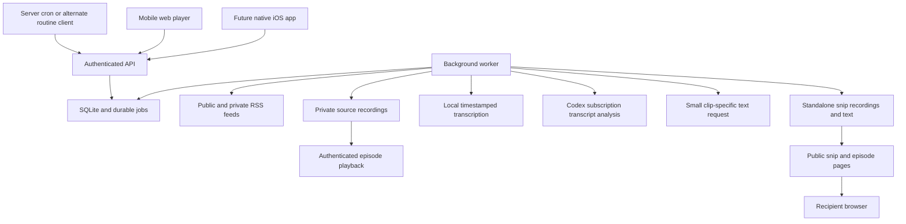

# Architecture and processing

The backend owns subscriptions, audio versions, transcripts, chapters, snips, and public links. The web app, an AI routine, and the eventual iOS app are clients of that backend. All architecture choices below are proposals; no services or credentials have been configured.

## Components and this server

| Layer | Proposed choice | Reason |
| --- | --- | --- |
| Mobile web UI | React + TypeScript, built with Vite; installable PWA | Fast iteration on listening and editing; nginx can serve the production assets |
| API | TypeScript + Fastify; versioned JSON API and an OpenAPI contract | One stable interface for web, routines, and Swift clients |
| Background work | Node worker with durable jobs; constrained FFmpeg, Python transcription, and Codex CLI processes | Downloads and AI work survive closed browsers and process restarts |
| Database | SQLite on local disk, WAL mode, foreign keys, migrations, full-text search | Appropriate starting point for one owner on one host |
| Media | Files outside the web root, addressed internally by asset IDs/hashes | Stable playback timeline and independently retained clip recordings |
| AI | Local faster-whisper and subscription-authenticated Codex CLI behind separate adapters | Batch transcription and analysis; replaceable providers and portable backend |
| Deployment | Existing nginx + dedicated non-root systemd services | Matches the inspected host; avoids requiring a new container platform |
| Future iOS | SwiftUI + native playback and downloads against the same API | Native audio behavior while preserving server-side processing and links |

[Fastify documentation](https://fastify.dev/docs/latest/) and [Vite deployment guidance](https://vite.dev/guide/static-deploy.html) support this application structure. Serve built assets in production; Vite's preview command is for local review.

Read-only inspection on September 14, 2026 found Ubuntu 24.04.3, 4 available CPU threads, 7.6 GiB RAM with approximately 3.5 GiB available at that moment, no swap, and about 108 GiB available on the workspace filesystem. nginx, systemd-managed apps, and Tailscale are already running. Node, Python, FFmpeg, and ffprobe were detected. Docker, a PostgreSQL client, and NVIDIA tooling/device nodes were not detected in the inspected environment. This is a resource snapshot, not a throughput benchmark or confirmation of public ingress.

Codex CLI 0.154.0 is installed and reports ChatGPT sign-in. An unattended analysis run and subscription capacity have not been tested. See the [Codex routine decision](codex-routines.md) for verified capabilities and the inference split.

Start with one active audio download, one constrained local transcription process, and one FFmpeg render; tune CPU and memory limits together so these do not saturate the host. Bound Codex analysis concurrency and prioritize snips over catalog work. Long-running transcription and remote-model waits must not occupy the API request handler or block the separate snip queue.

SQLite permits concurrent readers but one writer at a time, and WAL requires local shared storage. Keep transactions short, use a busy timeout, and perform network/AI/FFmpeg work outside transactions. Use an SQLite engine containing the WAL-reset fix: 3.51.3 or later, or an explicitly patched supported version. Verify the engine bundled by the selected driver. A move to PostgreSQL becomes appropriate for multiple worker hosts or measured write contention. [SQLite WAL documentation](https://sqlite.org/wal.html).



## One audio version defines every timestamp

A feed episode and a downloadable recording are different entities. Store a completed source recording, checksum, duration, codec, and acquisition metadata as an immutable **audio asset**. Playback, transcript words, chapters, and snips reference that asset ID. Never silently replace an asset in an active listening session.

This addresses changing ads: Snipd documents that dynamically inserted ads can change the stream version and shift playback. Applying yesterday's timestamps to a newly fetched enclosure is therefore unsafe. [Snipd's explanation](https://support.snipd.com/en/articles/10226286-random-jumps-during-playback).

Download to a temporary file, validate completion and decodability, then atomically move it into storage. For a resumed download, require matching source validators; otherwise restart rather than combine bytes from different versions. Prefer playing the stored recording even if AI processing is still pending. If a source must be converted for browser compatibility, record and validate the resulting time mapping. Do not remove ads or silence from the playback asset in the initial implementation.

If an episode is redownloaded later and its checksum differs, create a new asset and transcript version. Existing snips keep their original asset. Publisher chapters/transcripts also require alignment validation; matching an episode title or duration alone does not prove timing compatibility.

## Daily import and episode processing

1. Refresh subscriptions server-side, using conditional HTTP requests when available. Handle redirects, expired private-feed credentials, malformed feeds, and rate limits per feed.
2. Match episodes by feed identity plus stable item GUID. Preserve enclosure history. Use conservative fallbacks and collision review for broken/missing GUIDs; do not merge on title alone.
3. Discover new items from the complete returned feed, using first-seen identities as well as publication dates. An overlapping refresh window and a persisted set of known items catch late or backdated entries. A failed feed does not invalidate successful feeds.
4. Acquire the canonical audio asset and probe it. Enforce configurable duration, byte, disk-space, and monthly-processing limits; show deferred items rather than silently omitting them.
5. Import aligned publisher text where available, otherwise transcribe the stored audio locally with a timestamp-capable engine. Benchmark faster-whisper CPU INT8 first. If a hosted adapter is explicitly enabled later, upload bytes or a narrowly scoped temporary asset URL; never give a provider a private subscription URL.
6. Normalize results to integer milliseconds, word IDs, utterances, and speaker labels. Preserve provider/model/version provenance. If chunking is required, track offsets and overlap, deduplicate boundaries, and check speaker consistency across chunks.
7. Run bounded Codex CLI jobs using subscription authentication to generate chapters, a short episode preview, and reusable thought boundaries. Optionally precompute exact-span summaries to reduce clip-time inference. Validate the results against the transcript before marking them ready.
8. Update the episode's independently tracked audio, transcript, chapter, and summary states. Report ready, pending, deferred, and failed counts to the routine.

On first import, collect feed metadata and offer a backfill choice. The proposed default processes new items going forward, with selected older episodes available on demand. All future new episodes from enabled subscriptions enter the pipeline; a budget limit delays work visibly rather than redefining the subscription silently. RSS feeds may not expose their complete historical catalog, so a full backfill cannot be promised from RSS alone.

## AI chapter generation

Use timestamped utterances as the model input. Invoke the Codex adapter with a fresh task and output schema per bounded analysis job. For long episodes, propose topics within transcript windows, then merge them using adjacent context into a coherent episode-wide outline. Return structured chapter records containing a title, short description, and boundary word IDs. Compute times from the stored transcript rather than accepting invented timestamps. The ordinary worker validates and persists model output.

Validate chronological order, bounds, coverage, and non-overlap. A chapter's end is the next chapter's start, with the last ending at the measured episode duration. Label introductions, interludes, or advertisements when they explain gaps; avoid hundreds of tiny chapters. A 5–12 minute chapter is a useful initial preference, not a fixed requirement. Preserve publisher chapters as a separate source; AI chapters remain available as requested.

Treat episode speech and show notes as content, never instructions to the worker. The text-generation task has no authority to fetch URLs, reveal secrets, or invoke publication tools. Summaries should describe what a speaker said, preserve uncertainty, and avoid inventing speaker names. Keep source word IDs supporting generated statements for evaluation.

## Snip selection and automatic publication

At capture time, persist `audio_asset_id`, `transcript_version_id` if ready, `anchor_ms`, the recent continuous-listening interval, and `client_request_id`. The anchor comes from the audio player's source position, not elapsed wall-clock time. Return a snip ID and public URL immediately; the URL can remain in a generic preparing state until content is ready.

For an anchor `T`, choose `[start, end)` with:

```text
window_start = max(0, T - 180000, start_of_recent_continuous_listening)
window_start <= start < end <= T
30000 <= end - start <= 180000
```

The minimum duration has the short-episode/recent-seek exceptions in the [product specification](product.md). Use the last 180 seconds of eligible transcript to rank candidate sentence/utterance spans. Favor a self-contained thought, a complete question-and-answer exchange, and an ending near the tap. An ending up to roughly 15 seconds earlier accommodates reaction time; tune this against listening examples.

The normal clip-specific request returns word IDs for one contiguous span, a title/summary, and supporting word IDs for each summary claim. Validate the span and that every cited word belongs to it; semantic grounding still needs evaluation beyond schema checks. Extract **only the selected words** for the public transcript. If the summary cannot be accepted, regenerate it in an excerpt-only request before publication. Earlier context may help select a boundary, but must not supply extra facts in the published summary. If the preferred candidate is invalid or selection fails, choose a validated deterministic recent span, targeting 60 seconds. Never concatenate unrelated moments into one recording.

An exact precomputed candidate can reuse its scheduled summary, keyed by asset, transcript version, and boundary word IDs. This can reduce runtime inference to candidate selection, potentially deterministic ranking. A changed span requires a new matching summary; a larger chapter's summary is insufficient. The [routine decision](codex-routines.md) describes coverage and latency tradeoffs.

Create an immutable snip revision containing the selected timestamps, transcript excerpt, generated title/summary, and source provenance. Render a new standalone clip from the canonical recording, resetting its local timeline to zero and stripping inherited metadata/chapters. Use decoding and re-encoding for reliable cuts rather than assuming a packet-level copy produces exact boundaries. Check rendered duration and the first/last audible words. FFmpeg documents the difference between accurate seeking during transcoding and preserved pre-roll during stream copy. [FFmpeg seeking options](https://ffmpeg.org/ffmpeg.html#Main-options).

Publish in this order:

1. Write the clip file and selected text artifacts to non-public storage.
2. Check bounds, transcript containment, artifact hashes, and that the revision is still current.
3. Atomically mark that revision as the public share's active revision.
4. Make `/s/{token}`, its audio route, and transcript route resolve to that revision.

**Automatic publication applies equally to public- and private-feed snips.** There is no Share-button gate. A private parent episode stays owner-only; its public snip is an independent derivative asset.

If selection falls back, extract the selected transcript from the prepared episode and obtain a summary for that range before publication. If a provider is unavailable, keep retryable preparation state; do not publish fabricated text. A transcript-less episode queues its capture until scheduled preparation completes. Prioritizing local transcription of the recent window is an optional exception to the batch-only transcription policy; if enabled, reconcile its offsets to the same full audio asset.

When timestamps change, invalidate the previous public revision and queue a replacement. Old worker results cannot win a race against newer edits, deletions, or revocation. The public URL stays stable and resolves only through the share's current state. Explicitly revoked shares do not reactivate on edits or retries.

The public media handler authorizes against the share token and serves **only the clip file**, supporting HTTP range requests within that file. It must not accept an arbitrary asset ID, upstream URL, or timestamp range. Clip transcript requests must likewise read the materialized excerpt, not a full-transcript endpoint with client-side filtering. Gate episode collections through their selected active shares so revocation also removes their excerpts.

Public HTML and link-preview metadata use a whitelist: generated snip title, approved attribution fields, duration, and selected content. Do not serialize parent objects, private RSS URLs, raw source notes, nearby transcript text, or account data. Use no-index and no-store policies initially, no third-party analytics, and internal-only media paths. Revocation removes future service access; externally saved copies remain outside the service's control.

## Routine contract

Use server cron to request a refresh, get a job/run ID, and let durable workers advance ingestion, local transcription, and subscription-authenticated Codex analysis. The scheduled trigger itself does not require inference. Each transcript-ready analysis job invokes Codex independently; closing a client app does not stop server work. Preserve the same HTTP contract for alternate routine clients. See [Codex routines](codex-routines.md) for authentication, limits, and execution environments.

Proposed API request:

```http
POST /v1/refresh-runs
Authorization: Bearer <scoped routine credential>
Idempotency-Key: daily-<local-date>-<timezone>
Content-Type: application/json

{"mode":"daily","processing_policy":"saved"}
```

Proposed response:

```json
{
  "run_id": "run_example",
  "status": "queued",
  "status_url": "/v1/refresh-runs/run_example"
}
```

Return HTTP 202 for queued work. Replaying the same request key for the authenticated owner returns the existing run; conflicting payloads return a conflict. Also deduplicate per-episode work across different run IDs. The owner's saved timezone defines the daily window, including daylight-saving changes. Manual catch-up and any later timer/routine adapter call the same deduplicated operation. Record last success so a missed cron invocation is visible.

A thin MCP adapter can expose `refresh_subscriptions` and `get_refresh_status` later, using the same service functions. Remote MCP authentication should follow the applicable protocol and client support instead of assuming a raw API key works in every AI app. [MCP authorization specification](https://modelcontextprotocol.io/specification/2025-11-25/basic/authorization).

The refresh credential can enqueue runs and read status. The separate Codex analysis runner needs narrowly scoped transcript input, including private-feed text, and a channel for returning analysis artifacts. It must not receive feed credentials, feed-management access, or publication tools. Publication authority belongs to the owner's snip-creation action and deterministic worker. Store Codex authentication and any optional provider keys outside app-accessible data and source control. The run digest contains counts and app links without feed credentials or full private transcripts.

## Data model and API boundaries

| Record | Essential fields / invariant |
| --- | --- |
| Owner / device / credentials | Owner identity, timezone, device ID, revocable sessions and scoped automation credentials |
| Feed / subscription | Owner scope, encrypted feed URL, feed validators, processing policy, last successful refresh; private feeds never globally deduplicated across owners |
| Episode | Feed-scoped item identity, publication/first-seen dates, enclosure history, public attribution fields, source visibility |
| Audio asset | Episode ID, checksum, measured duration, codec, internal storage key, version, retention pins |
| Transcript version | Audio asset ID, provider/model, normalized words and utterances, confidence and language; immutable once referenced |
| Chapter set / episode summary | Transcript version, source/provenance, model/prompt version, validated boundaries |
| Thought candidate / cached summary | Asset and transcript version, exact boundary word IDs, summary and evidence, model/prompt version; reusable only for that exact span |
| Playback state / events | Owner, device/session, asset, position, speed, monotonically increasing event sequence and explicit finished state |
| Snip / revision | Owner, source asset, anchor, start/end, transcript excerpt, generated summary, separate personal note, revision number |
| Clip asset | Snip revision, storage key, checksum, measured duration, mapping from clip time to source time |
| Public share / episode collection | Opaque token, active revision, state/revocation; episode collections store selected share IDs and deliberately included text |
| Job / provider attempt / usage | Task key, lease, attempts, next retry, provider request/run ID, state, resource use, optional reserved/actual API cost, quota/authentication failure category |

Keep words as immutable normalized transcript artifacts with an indexed utterance/text projection; audio bytes do not belong in SQLite. A snip retains an excerpt snapshot so later transcript corrections cannot silently change a public quote.

| API surface | Contract |
| --- | --- |
| `POST /v1/subscription-imports`, `POST /v1/subscriptions` | Import preview/commit or add a feed; only the owner manages source credentials |
| `POST /v1/refresh-runs`, `GET /v1/refresh-runs/{id}` | Asynchronous refresh and status; routine scope allowed |
| `GET /v1/episodes/{id}` and `/transcript`, `/chapters`, `/audio` | Authenticated episode resources pinned to an asset/version |
| `POST /v1/playback-events` | Accept ordered, deduplicated device events; stale offline events do not overwrite a newer listening session |
| `POST /v1/snips` | Persist anchor, enqueue selection/rendering, and allocate automatic public share; deduplicate by client request ID |
| `PATCH /v1/snips/{id}` | Optimistic revision check; timestamp edits regenerate and automatically update public content |
| `POST /v1/episode-shares` | Create/update a selected collection and optional note; independent of whether listening has finished |
| `POST /v1/shares/{id}/revoke` | Withdraw current public content and prevent delayed jobs from republishing |
| `GET /s/{token}` and `/audio`, `/transcript` | Public snip-only resources for the active revision |
| `GET /e/{token}` | Public episode collection; full private source data remains inaccessible |
| `GET /v1/exports` | Owner export of subscriptions, transcript data, snips, and their provenance in documented portable formats |

Resume state cannot use the maximum historical position: deliberate rewinds and re-listening are valid. Reconcile device/session ordering explicitly; clip-preview playback must not change full-episode progress.

## Operations and the native path

Use leased durable jobs with heartbeat/retry, a unique task key, bounded exponential backoff, and visible failed/deferred states. Persist available Codex/provider attempt IDs and results before advancing jobs; authenticate any optional hosted-provider callbacks. Defer analysis on subscription limits or authentication failure without blocking playback or silently enabling paid fallback. Bound local CPU/RAM and scheduled analysis work. For optional paid adapters, reserve estimated spend before dispatch and reconcile actual receipts; do not promise exactly-once vendor billing across ambiguous network failures.

Protect owner routes with an established session/passkey or OIDC implementation. Web sessions use secure HttpOnly cookies and CSRF protection; native and automation clients use revocable scoped credentials. Fetch RSS/enclosures with URL validation, redirect-by-redirect public-network checks, response size limits, and no arbitrary filesystem protocols. Disable XML external entities and sanitize show-note HTML. Feed-supplied URLs must not reach loopback, private networks, or cloud metadata endpoints.

Use application encryption for feed credentials with the key outside the database, redact tokens/URLs from logs, and retain only necessary source metadata. Back up the database through SQLite's supported online backup mechanism, plus source/clip files and separately protected keys. Test a restore with an active public snip. Keep saved-snip source assets pinned to preserve timestamp editing; evict only unpinned cache according to the owner's retention policy. A cache purge must not break public recordings.

Deploy under a new HTTPS hostname after validating DNS, TLS, public ingress, available port, backups, and resource limits. The owner interface requires authentication; `/s` and `/e` must work from outside the Tailnet. No domain or public route was selected or changed during this research.

The native companion should use SwiftUI with AVPlayer, a playback audio session, Now Playing metadata, remote command handling, resumable downloads, an offline outbox for snips/progress, and universal links to the same public URLs. It should consume the existing API, not reproduce the AI pipeline on-device. [Apple media playback guidance](https://developer.apple.com/library/archive/documentation/AudioVideo/Conceptual/MediaPlaybackGuide/Contents/Resources/en.lproj/RefiningTheUserExperience/RefiningTheUserExperience.html), [universal links](https://developer.apple.com/documentation/Xcode/supporting-associated-domains?changes=_2).

Test web playback on a physical iPhone early: foreground, locked screen, headset controls, incoming calls, Bluetooth route changes, and network transitions. If browser behavior fails the daily-listening standard, bring the native playback milestone forward. A Mac/Xcode signing environment and an Apple developer setup are separate from this Ubuntu deployment host.
